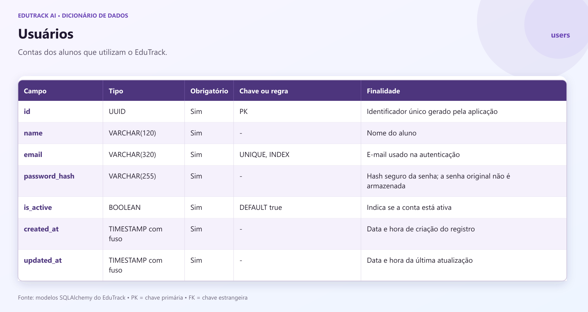
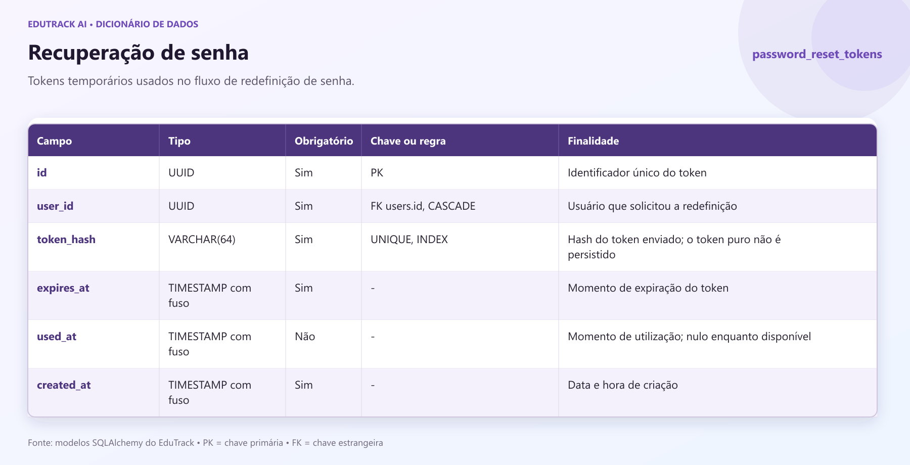
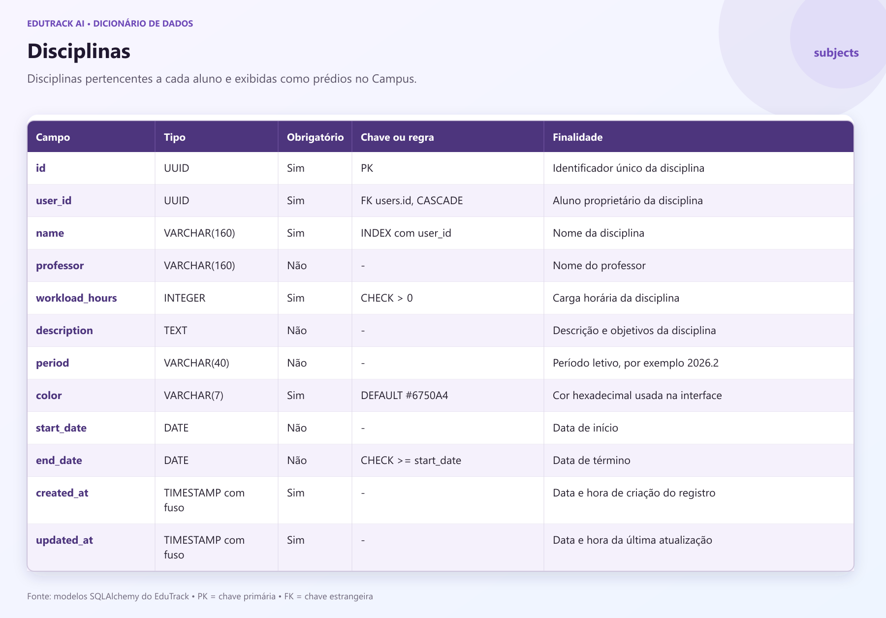
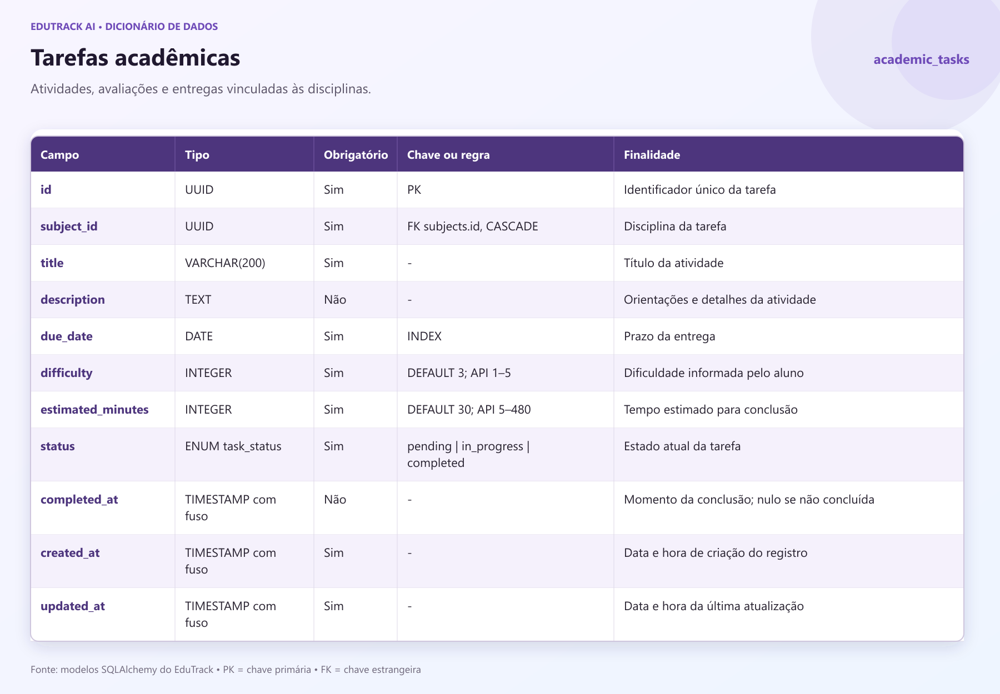
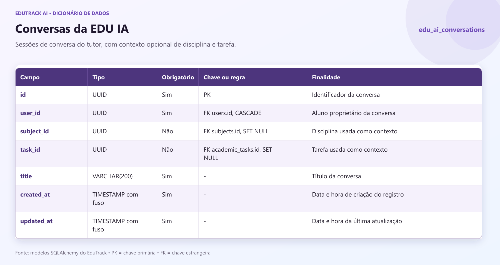
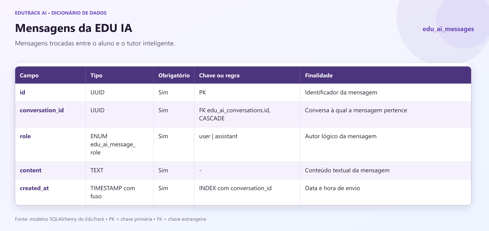
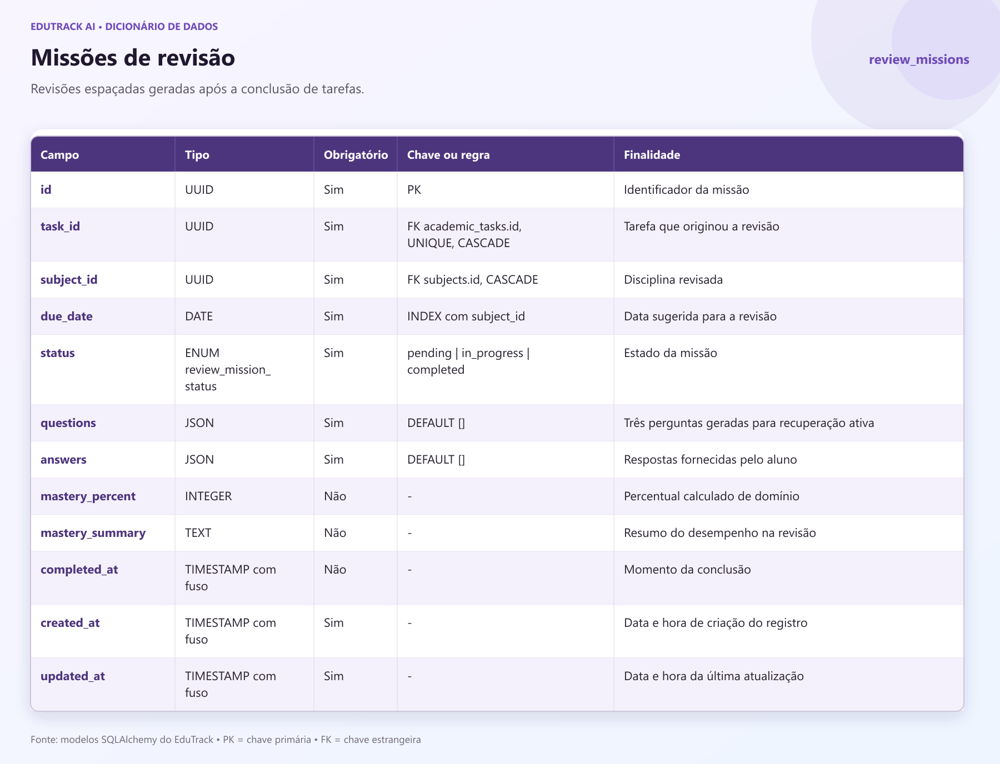
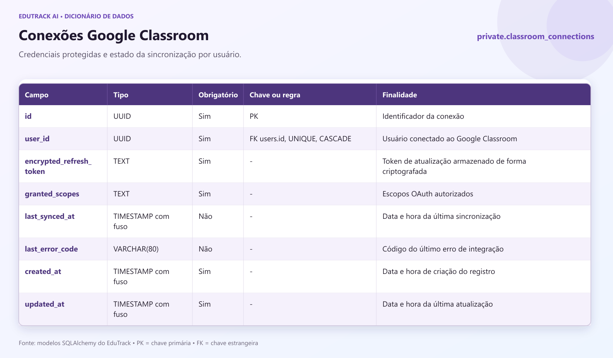
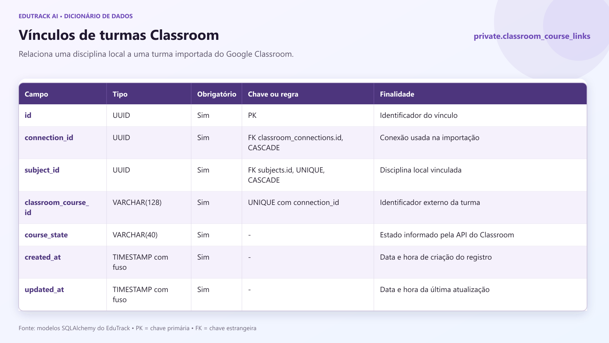
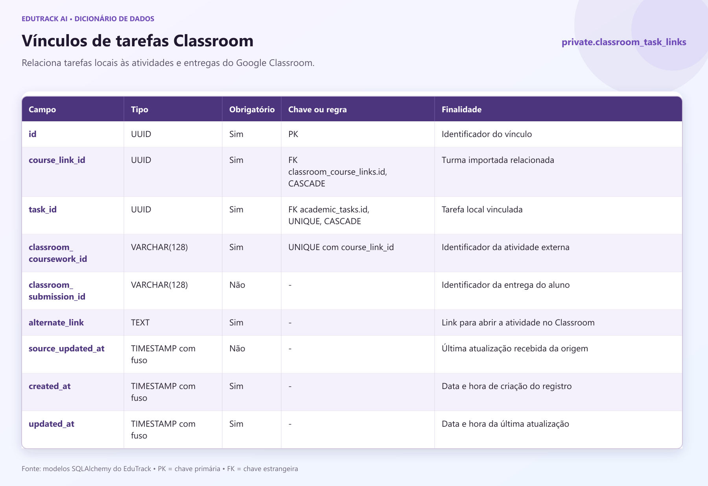

# Dicionário de dados do EduTrack

Este material apresenta as tabelas persistidas pelo EduTrack com base nos modelos SQLAlchemy atuais em `app/models/`. Cada print informa o campo, o tipo, a obrigatoriedade, as chaves ou regras e a finalidade na aplicação.

## Legenda

- **PK**: chave primária.
- **FK**: chave estrangeira.
- **UNIQUE**: valor ou combinação que não pode se repetir.
- **CASCADE**: a exclusão do registro pai remove o registro dependente.
- **SET NULL**: a exclusão do registro relacionado preserva este registro e limpa a referência.

## Tabelas

### 1. Usuários

### 2. Recuperação de senha

### 3. Disciplinas

### 4. Tarefas acadêmicas

### 5. Conversas da EDU IA

### 6. Mensagens da EDU IA

### 7. Missões de revisão

### 8. Conexões Google Classroom

### 9. Vínculos de turmas Google Classroom

### 10. Vínculos de tarefas Google Classroom

## Relações principais

- Um usuário possui várias disciplinas.
- Uma disciplina possui várias tarefas.
- Uma tarefa pode gerar uma missão de revisão.
- Uma conversa da EDU IA possui várias mensagens e pode referenciar uma disciplina ou tarefa.
- Uma conexão do Google Classroom possui vínculos de turmas, e cada vínculo de turma possui vínculos de tarefas.

Os valores de hashes, tokens de recuperação e tokens criptografados não devem ser exibidos na apresentação. Mostre somente as definições dos campos.
