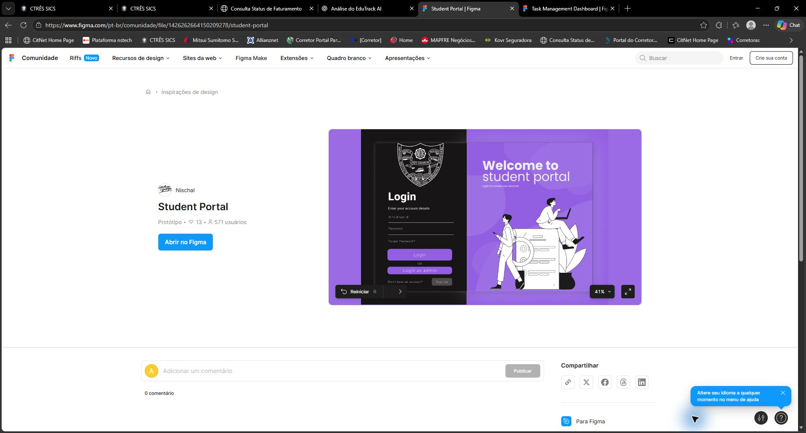
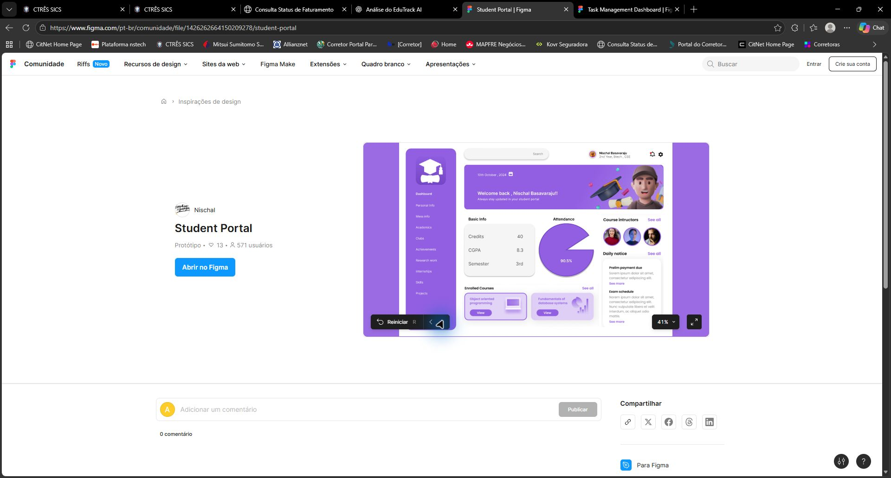
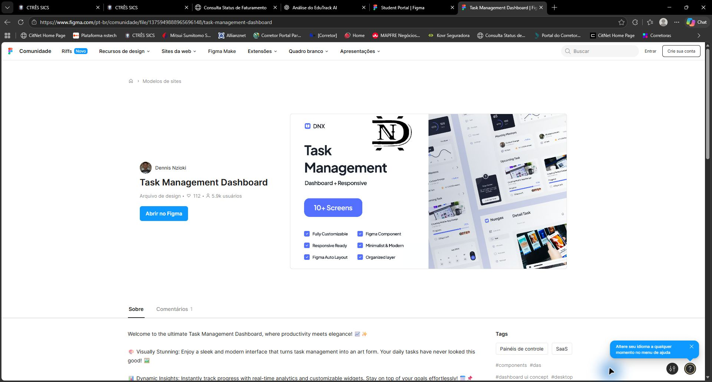
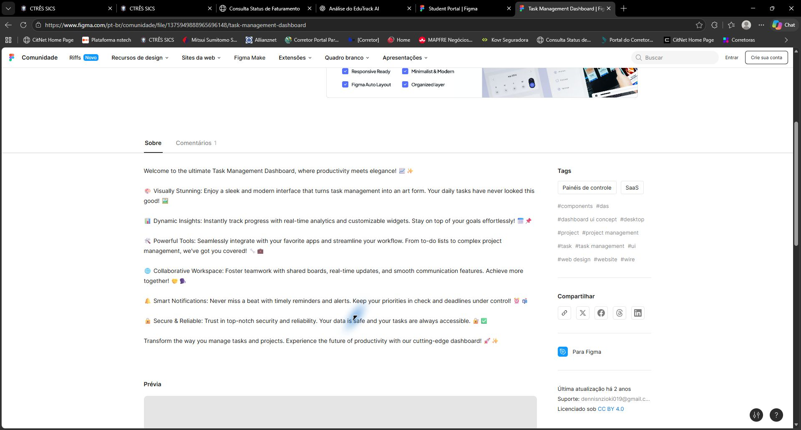

# EduTrack AI - Pesquisa de referências visuais (Tarefa 06)

**Disciplina:** Innovation Lab: Desenvolvimento Avançado No/Low Code\
**Data da pesquisa:** 18/11/2026\
**Natureza:** benchmarking retrospectivo de interfaces.\
**Estado da pesquisa:** fontes públicas inspecionadas e capturas reais coletadas; acesso ao editor, duplicação e inspeção interna de camadas não realizados por exigir autenticação.

## Objetivo

Identificar e analisar ao menos dois recursos do Figma Community relevantes ao EduTrack AI, destacando decisões de navegação, hierarquia visual e apresentação das informações acadêmicas. Esta pesquisa foi realizada **após a implementação inicial da interface**; por isso, representa uma análise comparativa para possíveis melhorias, não uma alegação de inspiração histórica.

## Referência 1 - Student Portal

- **Autor identificado na página:** Nischal.
- **Link:** https://www.figma.com/community/file/1426262664150209278/student-portal
- **Categoria exibida:** protótipo / inspiração de design acadêmico.
- **Evidência:** [página do Community](img/01-student-portal-community.png) e [prévia do dashboard](img/02-student-portal-prototipo.png).

**Observações verificadas nas prévias:**

1. Navegação lateral persistente separa áreas do perfil e do acompanhamento acadêmico.
2. O dashboard apresenta boas-vindas, indicadores gerais, gráfico de frequência, avisos e cartões de disciplinas/cursos.
3. Os cartões separam indicadores de progresso, informações acadêmicas e conteúdos do estudante sem apresentar tudo em um bloco único.
4. A identidade visual usa roxo de forma consistente entre as prévias de autenticação e dashboard.

**Aplicação possível no EduTrack AI:** avaliar se o Campus e a navegação por disciplinas podem ganhar maior clareza na apresentação de progresso, carga horária e próximas tarefas. Não foi copiado qualquer componente do template.

**Limitação:** a captura mostra o protótipo na página pública. Não foram comprovadas duplicação, edição de camadas, gratuidade de uso dentro do editor nem acesso ao arquivo privado.

## Referência 2 - Task Management Dashboard

- **Autor identificado na página:** Dennis Nzioki.
- **Link:** https://www.figma.com/community/file/1375949888965696148
- **Categoria exibida:** arquivo de design / painel de gerenciamento de tarefas.
- **Evidência:** [página do Community](img/03-task-management-community.png) e [descrição pública](img/04-task-management-detalhes.png).

**Observações verificadas na página e na prévia:**

1. A apresentação pública destaca visão geral, tarefas próximas e painel de detalhes de uma atividade.
2. Os cartões de tarefas evidenciam progresso, prazos e elementos de prioridade, com hierarquia visual clara.
3. A prévia separa informações resumidas e detalhes operacionais, evitando sobrecarregar a área principal.
4. O material promocional menciona mais de dez telas, responsividade, componentes, Auto Layout e camadas organizadas; **essas características foram declaradas pelo autor, não verificadas no editor**.
5. A página apresenta indicação de licença **CC BY 4.0**. Essa informação é um registro da página observada, não uma auditoria jurídica da licença.

**Aplicação possível no EduTrack AI:** comparar a lista de tarefas, os filtros, os cartões de prazo e o detalhamento da missão com a distribuição das informações do template. A identidade própria do Campus deve ser preservada.

**Limitação:** o botão "Abrir no Figma" é visível, sem preço na página pública, mas a autenticação impediu o acesso ao editor. Não foi confirmado que o arquivo pôde ser duplicado nem que seus componentes internos estão acessíveis gratuitamente.

## Comparação para o EduTrack AI

| Aspecto | Student Portal | Task Management Dashboard | Possível aprendizado |
| --- | --- | --- | --- |
| Foco | Visão acadêmica do estudante | Acompanhamento e execução de tarefas | Separar panorama acadêmico e ação específica |
| Navegação | Barra lateral persistente | Áreas de visão geral, tarefas e detalhes | Tornar a localização de funcionalidades mais rápida |
| Informação destacada | Frequência, disciplinas, avisos | Prazo, progresso, cartões de tarefa | Destacar situação atual e próxima ação |
| Composição | Cartões acadêmicos e gráfico | Painéis de métricas e detalhes | Evitar sobrecarga e manter leitura simples |
| Verificação interna | Editor indisponível | Editor indisponível | Não afirmar análise direta de camadas |

## Método, ética e limites

- Pesquisa realizada em **18 de novembro de 2026**, após a interface do EduTrack AI já existir.
- As quatro imagens anexadas são **capturas reais do Microsoft Edge** fornecidas durante a atividade; representam páginas públicas do Figma Community, não arquivos internos copiados.
- A presença do botão **Abrir no Figma** não prova a efetiva duplicação de nenhum recurso.
- Não houve login automatizado, remix, cópia de componentes para o EduTrack AI nem alteração no código do projeto.
- A exploração do Xano foi deixada fora deste levantamento, pois Xano não é obrigatório na arquitetura adotada para o projeto.
- Antes de afirmar o cumprimento integral da etapa de duplicação e estudo de camadas, seria necessário abrir os arquivos em uma conta Figma autorizada e registrar a inspeção real.

## Fontes

1. Figma Community, Student Portal: https://www.figma.com/community/file/1426262664150209278/student-portal
2. Figma Community, Task Management Dashboard: https://www.figma.com/community/file/1375949888965696148
3. Repositório do projeto: https://github.com/DaniloCH310/edu-track-ai
